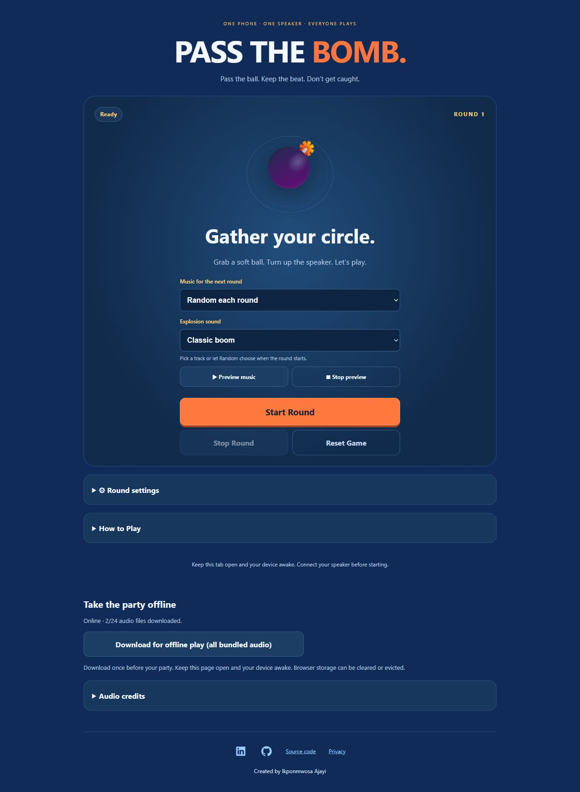

# Pass the Bomb 💣

A free, noncommercial party game for one phone, one speaker, and a circle of friends. Pass a soft ball while the music plays—whoever holds it when the bomb explodes loses!

**[Play now](https://bomb.ajayi.net/)** · [Streamlit version](https://ajayi108-pass-the-bomb.streamlit.app/)

<a href="https://bomb.ajayi.net/"></a>

## Play

1. Connect your speaker and gather in a circle with a soft ball.
2. Pick music or **Random each round**, then choose one of four explosion sounds.
3. Press **Start Round** and pass the ball. If it is airborne at the explosion, the thrower loses.

Includes **20 music tracks**, adjustable round lengths and volumes, optional automatic rounds, animations, and custom MP3/WAV uploads (15 MB / 10 minutes each). Custom files stay in your browser session.

For offline play, open the main site online and choose **Download for offline play**. Wait until all audio is ready. Keep the page open and your device awake during play.

## Run locally

Requires Python 3.11+.

```sh
python -m pip install -r requirements.txt
python -m streamlit run app.py
```

For the standalone Cloudflare version:

```sh
python cloudflare/build.py
python -m http.server 8080 --directory cloudflare/dist
```

Open `http://localhost:8080`. See [Cloudflare deployment instructions](cloudflare/README.md). The live Cloudflare project uses folder uploads; GitHub pushes update Streamlit automatically.

## Audio and project details

- [Audio sources, licenses and attribution](ASSET_CREDITS.md)
- [Privacy policy](https://bomb.ajayi.net/privacy)
- [Validation notes](VALIDATION.md) · Run checks: `node --test tests/game.test.mjs`

To add bundled audio, place licensed files in `assets/audio/`, update `audio_catalog.json` or `explosion_catalog.json`, and update the credits. Rebuild and redeploy Cloudflare after changes.

Created by **Ikponmwosa Ajayi** · [LinkedIn](https://www.linkedin.com/in/ikponmwosa-ajayi/) · [GitHub](https://github.com/Ajayi108)
